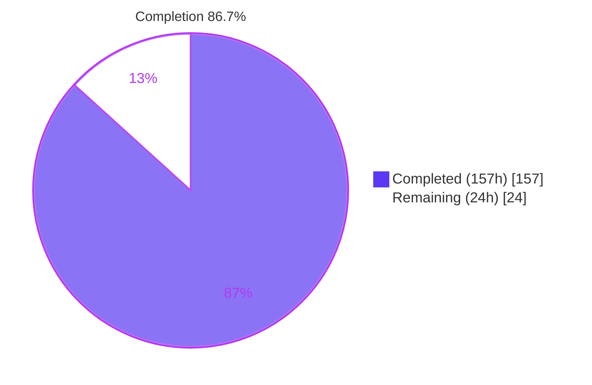
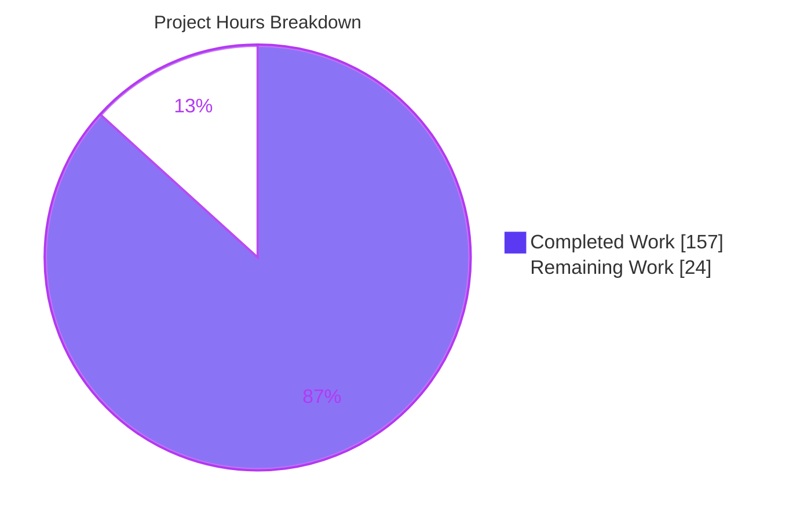
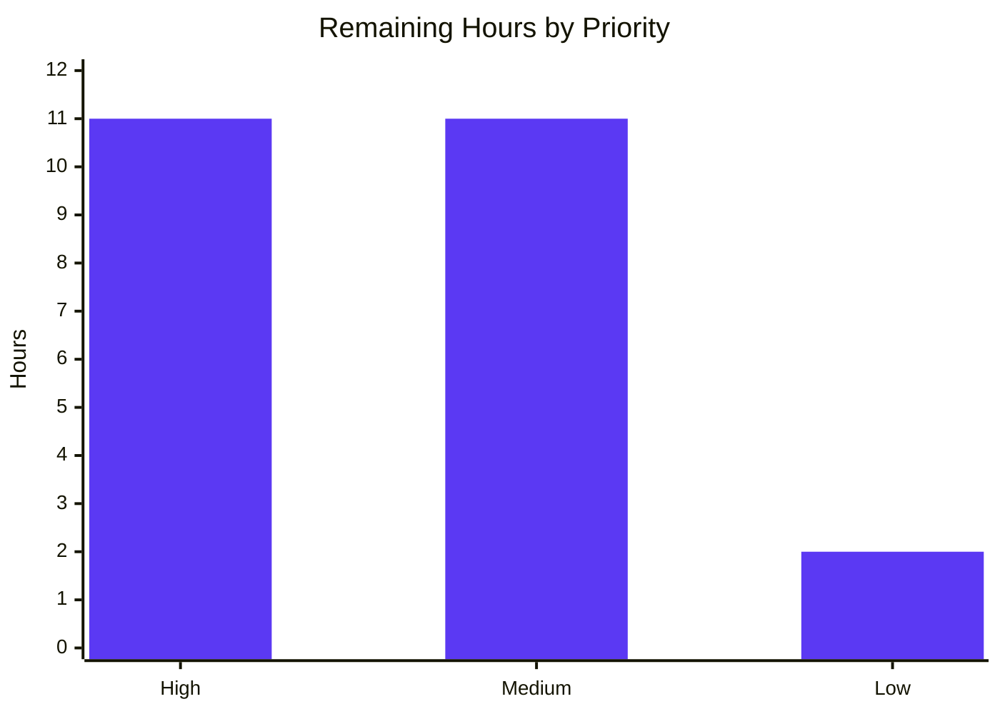

# 1. Executive Summary

## 1.1 Project Overview

Plant Parent is a client-only web app for tracking when each house plant was last watered. Users add plants by name and date, press **Water now** to stamp today's date, and keep the list across reloads through `localStorage`. The product is three static files (`index.html`, `styles.css`, `app.js`) that open straight from disk or any static host, with no build, backend or account. A development-only `tests/` package proves it: unit and browser suites, a confined static server, and a real-device manual-pass procedure.

## 1.2 Completion Status



| Metric | Value |
|---|---|
| Total Hours | 181 |
| Completed Hours (AI + Manual) | 157 (157 AI + 0 manual) |
| Remaining Hours | 24 |
| Percent Complete | **86.7%** (157 / 181 × 100) |

## 1.3 Key Accomplishments

- [x] Add, list, **Water now** and reload persistence work in file and served mode at 360 px and 1280 px
- [x] All 14 success criteria and 11 required states pass as 72 of 72 browser checks
- [x] 240 of 240 unit tests pass; model and storage code is at 100% line and function coverage
- [x] Stored data is exactly `{id, name, lastWatered}`; blocked, full and corrupt storage show the specified notices
- [x] Names render as text only; `app.js` has no `innerHTML`, `eval`, network calls or console output
- [x] Keyboard use, 44 px targets, visible focus and button names (`Water now: <name>`) verified in Chromium
- [x] The commit is exactly the 18 planned files; the test toolchain has 0 known vulnerabilities
- [x] `tests/manual-pass.md` gives a tester a ready procedure and 32-row results table

## 1.4 Critical Unresolved Issues

5 items are open. At requirement level, 2 of 26 AAP requirements are unmet: the real-device manual pass and the done state that depends on it. At result level, 32 of 32 manual-pass rows are unrecorded. Each needs a person, a real device or a non-Chromium browser.

| Issue | Impact | Owner | ETA |
|---|---|---|---|
| Real-device manual pass not run: 32 of 32 rows in `tests/manual-pass.md` are `Pending` (Firefox 14, iOS Safari 10, Edge 4, macOS Safari 4); see Section 5.2 D5 | Release-blocking: the AAP done state requires a recorded pass | QA tester | 1–1.5 days |
| Real screen-reader speech (NVDA, VoiceOver) never heard | Spoken refused-submit messages and Water now dates unconfirmed | Accessibility tester | 0.5 day |
| Browser menu paths and the iOS date picker's Reset control unexercised | Those procedure steps are unproven until run | QA tester | During manual pass |
| Firefox and Safari rendering of the stylesheet additions and `blocking="render"` unverified | Possible ~1 px glyph trim in Safari; first paint differs where the attribute is ignored | Front-end developer | 1 hour |
| Static server's Windows fallback path unexercised | LAN-mode testing from Windows is unproven | Developer | 1 hour |

## 1.5 Access Issues

No access issues identified. No credentials, external services or private registries are needed.

## 1.6 Recommended Next Steps

1. [High] Run the desktop Firefox file-mode pass (criteria 1–14) and the iOS Safari served-over-LAN pass in `tests/manual-pass.md`.
2. [High] Run the Edge and macOS Safari file-mode spot checks (criteria 1, 2, 5, 7).
3. [High] Record all 32 result rows with versions, tester and date, and commit them.
4. [Medium] Listen to refused-submit and Water now announcements with NVDA and VoiceOver.
5. [Medium] Review and merge the branch, deciding whether the static-server caveats (Section 5.2 D6) need committed tests.

# 2. Project Hours Breakdown

## 2.1 Completed Work Detail

| Component | Hours | Description |
|---|---|---|
| Plant model (`app.js` block 1) | 14 | `validateName`, six-step `validateDate`, `validatePlantInput`, local-date and en-US UTC formatting, collision-free `p-` + 32-hex ids, `createPlant`/`addPlant`/`markWatered`, `normalizeStoredPlants`; DOM-free and non-throwing |
| Storage module (`app.js` block 2) | 6 | `createPlantStorage` with remembered handle resolution, load validation table, write-back policy, projection to `{id, name, lastWatered}`, quota and blocked-storage results |
| Rendering and event wiring (`app.js` blocks 3–4) | 14 | Fragment-based list render returning the button map, notice and field-error rendering with ARIA, submit and Water now handlers, focus restoration, date-input refresh on focus/visibility/midnight, single `commit` path |
| App structure, header and JSDoc | 2 | One strict IIFE, five banners, entry guard exporting `{model, storage}`, Google-style JSDoc on every function |
| `index.html` | 3 | Semantic page shell, labelled form with inline error slots, live notices region, hidden empty state and list, inline empty favicon |
| `styles.css` | 10 | Design tokens, 40rem centred column, wrapping rows, 44 px targets, focus ring, hover-only states, 360 px wrap rule, paint containment for long names |
| Development manifests | 2 | `tests/package.json`, pinned `tests/package-lock.json`, `tests/.gitignore` |
| Loader and fake storage | 4 | `tests/support/load-app.js` same-realm loader; `tests/support/fake-storage.js` with failing writes and blocked access |
| Static test server | 14 | `tests/support/static-server.js`: root-file-only GET/HEAD, symlink and traversal refusal, bounded request log, CLI with `HOST`/port validation |
| Unit suite | 22 | 240 tests in six files: names, dates across five time zones, model, storage, Water now |
| Browser harness | 24 | `tests/browser/harness.js`: four-run matrix, fixed clock and zone, seeding and blocking, persistent-profile relaunch, evidence and network logs, failure gating |
| Browser criteria | 24 | `tests/browser/criteria.test.js`: C01–C14 and S1–S4 with screenshots and network evidence |
| Manual-pass procedure | 6 | `tests/manual-pass.md`: prerequisites, per-platform steps, stored-value checks, 32-row results table |
| Cross-cutting verification | 12 | Accessibility and performance audits, scale tests to 5,000 rows, typed-input injection and static-server security probing |
| **Total** | **157** | |

## 2.2 Remaining Work Detail

| Category | Hours | Priority |
|---|---|---|
| [AAP 0.13.4] Desktop Firefox file-mode manual pass, criteria 1–14 | 4 | High |
| [AAP 0.13.4] iOS Safari served-over-LAN manual pass, criteria 1–7, 9, 13, 14 | 4 | High |
| [AAP 0.13.4] Edge and macOS Safari file-mode spot checks, criteria 1, 2, 5, 7 | 2 | High |
| [AAP 0.13.5] Record 32 result rows and commit `tests/manual-pass.md` | 1 | High |
| [Path-to-production] Fix and re-gate any defect the manual pass finds (contingency, low confidence) | 4 | Medium |
| [AAP 0.1.1 NFR] Screen-reader speech check with NVDA and VoiceOver | 2 | Medium |
| [AAP 0.5.5] Firefox/Safari check of stylesheet additions and `blocking="render"` | 1 | Medium |
| [Path-to-production] Branch review, merge and release sign-off | 4 | Medium |
| [AAP 0.7.2] Static-server caveat decision and Windows LAN fallback check | 2 | Low |
| **Total** | **24** | |

## 2.3 Hours Summary

157 completed + 24 remaining = 181 total hours. Completion = 157 / 181 × 100 = **86.7%**. The remaining hours are almost entirely the human-only real-device pass the AAP requires; the 4-hour defect contingency carries low confidence because its size depends on what that pass finds.

# 3. Test Results

All figures below were observed in a run at HEAD `5dbe2a2` on Node v22.23.4 with Playwright 1.64.1 (Chromium 156.0.8078.4).

| Area / Category | Framework | Tests | Passed | Failed | Coverage | What This Proves |
|---|---|---|---|---|---|---|
| Name and date validation (`tests/unit/name-validation.test.js`, `date-validation.test.js`) | `node:test` | 74 | 74 | 0 | Block 1: 100% line/function | Names and dates are accepted or refused exactly as specified, with the specified messages |
| Date formatting across time zones (`tests/unit/date-format.test.js`) | `node:test` | 63 | 63 | 0 | Block 1: 100% | Dates display as `Mar 3, 2025` and "today" is the local date in every zone tested |
| Plant model and Water now (`plant-model.test.js`, `water-now.test.js`) | `node:test` | 35 | 35 | 0 | Block 1: 100% | Ids are unique, lists append in order, and Water now changes only the target plant |
| Storage (`tests/unit/storage.test.js`) | `node:test` | 68 | 68 | 0 | Block 2: 100% line/function | Saved data loads, is repaired or raises the specified notice; blocked, full and corrupt storage never lose the session |
| Success criteria C01–C14 (`tests/browser/criteria.test.js`) | Playwright + `node:test` | 56 | 56 | 0 | — | Every user-facing criterion, including corrupt and blocked storage, holds in file and served mode at 360 px and 1280 px |
| Required states S1–S4 (`tests/browser/criteria.test.js`) | Playwright + `node:test` | 16 | 16 | 0 | — | A failed save, a page left open past midnight, duplicate names and an already-today Water now behave as specified |
| Static checks | `node --check`, grep R1–R6, `npm audit` | 8 | 8 | 0 | — | `app.js` parses, keeps storage in block 2, uses no `innerHTML`/`eval`/network/console, and the toolchain has 0 vulnerabilities |

**Totals:** 240 of 240 unit tests (41 suites, 0.1 s), 72 of 72 browser checks (4 runs, 42.1 s), 8 of 8 static checks. Overall `app.js` coverage is 68.77% line, 98.94% branch and 64.52% function; every uncovered line lies in the rendering, wiring and entry blocks after line 451, which the browser suite exercises instead, so the coverage gate is met.

**Not Covered**

- Firefox, Safari (macOS and iOS) and Edge: no automated test runs outside Chromium. Run the procedure in `tests/manual-pass.md` before release.
- Real screen-reader speech: the accessibility tree and ARIA attributes are asserted, but no test hears NVDA or VoiceOver output.
- The hardening in `tests/support/static-server.js` (symlink refusal, bounded request log, protocol edge cases) has no committed tests; the browser suite exercises only its normal serving path.
- The static server's Windows open-flags fallback, its IPv6 `[::1]` origin and its close-failure warning path are not exercised.
- LAN mode (`HOST=0.0.0.0`) on a phone is not exercised; it is part of the iOS manual pass.

# 4. Runtime Validation & UI Verification

The app was driven in Chromium in both run modes, at 360 px and 1280 px, through the browser suite and by hand. There is no login, backend or external integration to exercise.

- ✅ **Start-up (file and served mode)** — `index.html` renders the "Plant Parent" heading, the **Add a plant** form with Last watered prefilled to today and capped at today, and "No plants yet. Add your first plant above."; 0 console messages.
- ✅ **Add plant** — a valid submit appends a row (`Monstera`, "Last watered Oct 23, 2026"), hides the empty state, clears and refocuses Name; an empty name shows "Enter a plant name" with `aria-invalid="true"` and adds nothing.
- ✅ **Water now** — the target row's date becomes today in place, row order is unchanged, the page does not reload, and focus returns to that plant's re-rendered button; pressing it again on the same day is silent.
- ✅ **Persistence** — `plant-parent.plants.v1` holds a JSON array of exactly `{id, name, lastWatered}` with stable ids; rows and dates survive reload and, in the suite, a full browser relaunch.
- ✅ **Keyboard and focus** — Tab order Name → date → Add plant → Water now; Enter and Space work; focus ring is `3px solid #2e6b47`, offset 2 px; button name `Water now: <name>` with the date as its description.
- ✅ **Untrusted input** — a name of `` renders as literal text, with no element created, no dialog and no request.
- ✅ **Layout** — no horizontal scroll at 360 px (Water now wraps under the text); at 1280 px a single 640 px centred column with 44 px buttons beside each row's text.
- ✅ **Network** — each load requests only `index.html`, `styles.css` and `app.js`; no favicon request and no requests during use.
- ✅ **Static server** — serves the three root files (200, `nosniff`, `no-store`), returns 404 for anything else and 405 for `POST`; a bad port argument prints usage and exits 1.
- ⚠ **Never exercised at runtime** — Firefox, Safari (macOS, iOS), Edge, real screen readers, LAN mode on a phone, and the static server on Windows.

# 5. Compliance & Quality Review

## 5.1 Compliance Matrix

| AAP Deliverable | Benchmark | Status | Evidence |
|---|---|---|---|
| FR-1 Add plant (0.5.1.4) | Valid adds; invalid keeps values, shows inline messages, focuses first invalid field | ✅ Pass | `app.js:723` `handleSubmit`; C02, C04, C09 |
| FR-2/FR-3 List and Water now (0.5.1.3) | Insertion order, specified row markup and date format; today stamp with focus restored | ✅ Pass | `app.js:498`, `app.js:760`; C03, C05, C06, C14, S4 |
| FR-4 Persistence (0.5.2) | Key `plant-parent.plants.v1`, exact projection, load validation, write-back policy | ✅ Pass | `app.js:331`–`449`; 68 storage tests; C07, C08, C10 |
| FR-5 and required states (0.6.1) | Empty state and all 11 states with verbatim messages | ✅ Pass | `app.js:43` `MESSAGES`; C01, C09–C11, S1–S4 |
| FR-6 Visual design (0.5.5) | Tokens, 40rem column, 44 px targets, no horizontal scroll at 360/1280 | ✅ Pass (Chromium) · ⚠ other browsers pending | `styles.css`; C13; runtime layout checks |
| NFR network, console, accessibility (0.1.1) | Only three files load; no console output; WCAG 2.2 AA contrast, focus, targets | ✅ Pass (Chromium) · ⚠ speech pending | C12 network logs; runtime keyboard pass |
| Code structure and boundaries (0.3.2, 0.12.1) | One strict IIFE, five banners, entry guard; R1–R6 return no code matches | ✅ Pass | `app.js:33`/`328`/`451`/`630`/`813` |
| Style, JSDoc, coverage gate (0.12.2) | Google JS style, JSDoc on every function, blocks 1–2 at 100% | ✅ Pass | Coverage run: uncovered lines start at 468, after banner 451 |
| File set and scope (0.9.1, 0.8.2, 0.4.1) | Exactly 18 files; four root entries; no out-of-scope features, CSP, CI or linter | ✅ Pass · see D7 | `git ls-files` = 18 |
| Support tooling (0.7.2) | Loader, fake storage, confined static server with CLI | ✅ Pass · see D1, D6 | `tests/support/` |
| Automated suites (0.13.2, 0.13.3) | Six unit files; C01–C14 and S1–S4 in four runs with evidence | ✅ Pass · see D2, D8 | 240/240 unit, 72/72 browser |
| Manual pass and done state (0.13.4, 0.13.5) | Procedure written; pass performed and 32 rows recorded | ⚠ Procedure complete · ❌ pass not run | `tests/manual-pass.md:343`; see D5 |

## 5.2 AAP & Rule Divergences and Gaps

The AAP sets no user rules (AAP 0.10), so every divergence below is measured against the AAP.

| What the AAP/Rule Required | What Was Delivered Instead | Why It Diverged | Impact | Remediation |
|---|---|---|---|---|
| D1 — Loader wraps `app.js` and compiles it with `vm.runInThisContext` (0.3.2, 0.7.2) | `vm.compileFunction(source, ['module', 'exports'], …)` (`tests/support/load-app.js:59`) | A wrapper-string prefix skews coverage line ranges | None on the product; coverage is accurate | None |
| D2 — One `chromium.launch()` per test file, headless Chromium (0.13.3) | Full Chromium via `channel: 'chromium'`; C12 launches its own browser per run | Headless shell never requests a favicon, and Chromium requests it once per browser | C12 proves the favicon half; `TMPDIR` must stay ≤ 60 chars | Keep `TMPDIR` short in any CI |
| D3 — Script tag `<script src="app.js" defer>`; row button named by `aria-label` only (0.3.2, 0.5.1.3) | Adds `blocking="render"`, `aria-describedby` to each row's date, and blur-before-refocus on refused submit | Avoids a blank first paint on reload; makes the date and refusal audible | Unverified outside Chromium | Firefox/Safari and screen-reader checks |
| D4 — Stylesheet holds the AAP 0.5.5 declaration list | Extra rules: 25rem wrap, paint clip, `nowrap` dates, date-input height, scroll margins, `--radius`, date focus ring | The listed rules alone do not wrap Water now at 360 px or contain long names | Safari ~1 px glyph trim; focus restore may scroll ≤ 8 px | Firefox/Safari visual check |
| D5 — A person runs the manual pass and records it; done state requires it (0.13.4, 0.13.5) | Procedure and 32-row table delivered; all rows `Pending` | Not performed in this run: it needs a person and real devices | **Release-blocking** | Run and record the pass |
| D6 — Static server logs every requested path and serves only root files (0.7.2) | No-`Host` and HTTP/2 preface requests unlogged; hard links not refused; no forced-shutdown timer; no committed server tests | Accepted caveats of a loopback-only dev tool; 0.9.1 fixes the file set | Low; matters only in LAN mode | Owner decision |
| D7 — "Every file is created; none is updated or deleted" (0.9.1) | Inherited `README.md` deleted (commit `67fda17`) | Conflicts with 0.1.1/0.8.1, which fix the root to four entries | No README in the repository | None, unless a README is wanted |
| D8 — Test doubles and checks as planned (0.13.2, 0.13.3) | File-mode C12 has no late-request wait; fake storage accepts prototype-supplied options; no module-level cross-zone `Map` | File mode has no server log; per-zone reload replaced the `Map` | Test-only; no product effect | None |

**D1 — Loader compile method.** AAP 0.3.2 and 0.7.2 specify that `tests/support/load-app.js` wraps `app.js` in a `(function (module, exports) { … })` string and compiles it with `vm.runInThisContext`. The loader instead calls `vm.compileFunction(source, ['module', 'exports'], { filename })` (`tests/support/load-app.js:51–59`). A textual wrapper prefixes the first line, which shifts the positions Node's coverage reports and could let the 0.12.2 gate pass when blocks 1–2 are not fully covered. `compileFunction` keeps the same realm, the same exports and exact line numbers. No change is needed, but the loader does not use the API the AAP names.

**D2 — Browser launch model.** AAP 0.13.3 asks for one `chromium.launch()` per test file using headless Chromium. `tests/browser/harness.js:152` launches full Chromium (`channel: 'chromium'`), and C12 runs in a browser launched for it alone (`tests/browser/criteria.test.js:1491`, `1545–1554`). The headless shell never requests `/favicon.ico`, so C12 could not prove the page avoids a favicon request, and Chromium issues that request once per browser, so a shared browser would hide it. The cost is a slower suite and a host constraint: a `TMPDIR` longer than about 60 characters aborts Chromium with "Socket path too long". Keep `TMPDIR` short wherever the suite runs.

**D3 — Markup and behaviour beyond the AAP's literal text.** AAP 0.3.2 quotes the script tag as `<script src="app.js" defer>` and 0.5.1.3 names the row button by `aria-label` alone. `index.html:17` adds `blocking="render"`, which avoids a blank-list first paint on reload in Chromium. `app.js:512` and `524` give each date line the id `plant-date-<index>` and point the button's `aria-describedby` at it, so screen readers hear the date. `app.js:738` blurs an already-focused invalid field before refocusing it, so a refused Enter is re-announced. Firefox and Safari ignore `blocking="render"`, and a Firefox change-on-blur edge is untested. Confirm all three during the manual pass.

**D4 — Stylesheet additions.** Every declaration AAP 0.5.5 lists is in `styles.css`, alongside rules the list does not name. At 360 px the AAP's `12rem` text basis leaves Water now beside the text (192 + 16 + 115 = 323 px of 328 px), so `styles.css:188–190` wraps it below. Lines 208–209 clip combining-mark overflow inside each row, 226 keeps dates on one line, 110 fixes the date input at 44 px, 291–303 add scroll margins, 24 adds `--radius` and 280 extends the focus ring to the date input. Safari lacks `overflow-clip-margin` and may trim about 1 px of an overhanging glyph; a pointer press near the viewport edge can scroll up to 8 px. Check visually in Firefox and Safari.

**D5 — Manual pass not performed.** AAP 0.13.4 requires a person to run `tests/manual-pass.md` in desktop Firefox (file mode, criteria 1–14), iOS Safari (served over LAN), and Edge and macOS Safari (file-mode spot checks), and 0.13.5 makes a recorded pass part of the done state. The procedure and its 32-row table exist (`tests/manual-pass.md:343`), but every row reads `Pending`. The pass was not performed in this run: it needs a person with physical devices and those browsers, which the Linux build and test environment does not provide. This blocks release; Section 2.2 carries the 11 hours to run and record it, plus a defect contingency.

**D6 — Static server caveats.** AAP 0.7.2 has `tests/support/static-server.js` log every requested path and serve only the root's own files. Requests with no `Host` header and an HTTP/2 `PRI` preface are rejected without a log entry; hard links inside the root are served, since only symlinks are refused; once the request-log budget trips (`static-server.js:337`, `615`) the server stops listening without a forced-shutdown timer. Its hardening has no committed tests, because AAP 0.9.1 fixes the commit at 18 files. The server binds `127.0.0.1` by default and is never shipped, so the impact is low; decide whether LAN-mode use warrants committed tests.

**D7 — README removal.** AAP 0.9.1 states "Every file is created; none is updated or deleted," yet the base branch held a two-line `README.md`. AAP 0.1.1 and 0.8.1 fix the repository root to `index.html`, `styles.css`, `app.js` and `tests/`, and 0.8.2 excludes extra documentation, so the two instructions cannot both hold. Commit `67fda17` deletes the README, giving the root-tree rule precedence; `git ls-files` lists exactly the 18 planned files. Behaviour is unaffected. If the owner wants a README, adding one is a deliberate change to the AAP's root layout.

**D8 — Test-tool caveats.** In file mode C12 does not wait for late requests, because there is no server log to settle on; served mode waits for a 5-second quiet period. `createFakeStorage` validates option names with `Reflect.ownKeys` but still reads values an options object's prototype supplies (`tests/support/fake-storage.js:42–44`). AAP 0.13.2's planned module-level `Map` for cross-zone formatting was replaced by re-evaluating `app.js` per zone in `tests/unit/date-format.test.js`, which still catches a local-zone formatter on any host. All three touch test code only; no action is needed.

# 6. Risk Assessment

| Risk | Category | Severity | Probability | Mitigation | Status |
|---|---|---|---|---|---|
| Behaviour, layout or date-input handling differs in Firefox, Safari or Edge, where no automated test runs | Technical | Medium | Medium | Run the full `tests/manual-pass.md` procedure before release | Open |
| File-mode `localStorage` does not persist across relaunch in Edge or macOS Safari (AAP assumptions A1/A2) | Integration | Medium | Medium | Spot-check criteria 1, 2, 5, 7 in file mode; fall back to serving the files if persistence fails | Open |
| Screen readers do not speak refused-submit messages or the updated Water now date as intended | Technical (accessibility) | Medium | Low | NVDA and VoiceOver listening check | Open |
| Interaction latency grows with list size: 15–25 ms at 500 rows, 176–449 ms at 5,000 rows, because every change re-renders the list | Technical (performance) | Low | Low | Acceptable for a personal plant list; revisit only if lists reach thousands of entries | Accepted |
| Plant data sits in plain text in `localStorage`; in Chromium every local file shares one `file://` origin; no CSP by design | Security | Low | Low | No secrets are stored; names render as text only; prefer served mode on shared machines | Accepted |
| LAN mode (`HOST=0.0.0.0`) exposes the root files to the local network, and the server's hardening and Windows fallback have no committed tests | Security / Operational | Medium | Low | Use LAN mode only on trusted networks for the phone pass; decide on committed tests (D6) | Open |
| Test tooling traps: a `TMPDIR` over ~60 characters aborts Chromium, and the coverage command exits 0 even when blocks 1–2 are uncovered | Operational | Low | Medium | Keep `TMPDIR` short; read the gate from the uncovered-lines column, or parse it in any CI | Open |
| Data edge cases accepted by the rules: a keyboard-typed year 10000 clamps to 0001-01-01, a name of only zero-width characters is accepted, stored id length is unbounded | Technical (data quality) | Low | Low | The AAP sets no minimum year or visible-character rule; tighten only if real data shows a need | Accepted |

# 7. Visual Project Status



**Remaining hours by priority (24 h total)**



| Priority | Hours | Work |
|---|---|---|
| High | 11 | Firefox, iOS Safari, Edge and macOS Safari manual pass; record 32 rows |
| Medium | 11 | Defect contingency, screen-reader speech, cross-browser CSS check, review and sign-off |
| Low | 2 | Static-server caveat decision and Windows LAN check |

# 8. Summary & Recommendations

Plant Parent is **86.7% complete** against the AAP: 157 of 181 hours are delivered and 24 remain. Every product capability the AAP specifies is built and verified in Chromium. Users can add plants, see them in insertion order with en-US dates, press Water now, and keep the list across reloads and browser relaunches. All 11 required states, including blocked, corrupt and full storage, show their exact messages. The shipped surface is three files totalling 1,189 lines, the commit is exactly the 18 planned files, and the page loads nothing beyond them.

Verification is thorough within one browser engine. 240 of 240 unit tests pass with the model and storage blocks at 100% line and function coverage. 72 of 72 browser checks pass across file and served mode at 360 px and 1280 px, with screenshots and network logs for each. The static boundary checks, `node --check` and `npm audit` (0 vulnerabilities) are clean. Hands-on runs confirmed keyboard-only use, focus restoration, literal rendering of markup-like names and the absence of console output.

The remaining gap is the real-device manual pass in desktop Firefox, iOS Safari, Edge and macOS Safari. The AAP makes that pass part of the done state, and all 32 result rows are still `Pending`. It is the critical path to release, at 11 hours plus a 4-hour contingency for anything it turns up. Real screen-reader speech, the stylesheet additions in non-Chromium engines and the static server's Windows path also remain unexercised.

**Production readiness:** ready for real-device validation, not yet for release. A release is justified once the manual pass records Pass on criteria 1–14 in Firefox, on the iOS criteria set in Safari, and on criteria 1, 2, 5 and 7 in Edge and macOS Safari file mode, with the automated gate still green. Settle the eight divergences in Section 5.2 at the same review: D5 must close, and D3, D4 and D6 need an explicit owner sign-off.

| Success metric | Current | Target for release |
|---|---|---|
| Automated browser checks | 72 / 72 | 72 / 72 |
| Unit tests | 240 / 240 | 240 / 240 |
| Blocks 1–2 coverage | 100% | 100% |
| Manual-pass rows recorded | 0 / 32 | 32 / 32 |

# 9. Development Guide

## 9.1 System Prerequisites

- **To use the app:** any current browser. No install, build or server is required.
- **To run the tests:** Node.js **22.5.0 or newer** (validated on v22.23.4 with npm 11.21.0), on Linux, macOS or Windows.
- **Browser binary for the suite:** Chromium 156.0.8078.4, installed by Playwright 1.64.1. It takes about 400 MB of disk space.
- **For the manual pass:** desktop Firefox, an iPhone with Safari on the same network as the computer, Edge, and macOS Safari. iOS stored-value checks need a Mac with Safari Web Inspector.

## 9.2 Environment Setup

No environment variables, secrets, databases or services are needed. Run every command from the repository root.

```bash
# Confirm the Node version (must be >= 22.5.0)
node --version
```

## 9.3 Dependency Installation

The dependencies are development-only and live under `tests/`. The repository root has no `package.json`.

```bash
# Install playwright 1.64.1 exactly as locked in tests/package-lock.json
npm ci --prefix tests

# Verify: prints "plant-parent-tests@0.0.0 … └── playwright@1.64.1"
npm ls --prefix tests

# First time on a new machine only: download the Chromium build
npx --prefix tests playwright install chromium
# On a fresh Linux host that also lacks the OS libraries:
# npx --prefix tests playwright install --with-deps chromium
```

## 9.4 Running the Application

**File mode** (the primary mode): open `index.html` from the repository root in a browser, by double-clicking it or through the browser's File › Open.

**Served mode** (development server, loopback only):

```bash
# Start on port 8000 in the background and note the pid it prints
nohup node tests/support/static-server.js 8000 > server.log 2>&1 & echo $!

# Expected log line: "Serving <repository root> at http://127.0.0.1:8000/index.html"
cat server.log

# Stop it with the pid printed above
kill <pid>
```

- With no port argument the server picks a free port and prints it.
- **Phone pass only:** `HOST=0.0.0.0 node tests/support/static-server.js 8080` binds every interface and prints the LAN URLs to open on the phone. Use it only on a trusted network.

## 9.5 Verification

A healthy start shows the heading "Plant Parent" and the **Add a plant** form, with Name empty and Last watered set to today. Below it reads "No plants yet. Add your first plant above.", and the browser console stays empty.

```bash
# With the served-mode server running on port 8000:
curl -s -o /dev/null -w "%{http_code}\n" http://127.0.0.1:8000/index.html   # 200
curl -s -o /dev/null -w "%{http_code}\n" http://127.0.0.1:8000/app.js       # 200
curl -s -o /dev/null -w "%{http_code}\n" http://127.0.0.1:8000/tests/package.json  # 404
```

**Automated checks:**

```bash
# Syntax check of the shipped script (exit 0, no output)
node --check app.js

# Unit suite: 240 tests, about 1 s
node --test "tests/unit/*.test.js"

# Browser suite: 72 checks (C01–C14, S1–S4 × four runs), about 45 s.
# Writes screenshots and logs to tests/evidence/ (git-ignored).
node --test --test-concurrency=1 "tests/browser/*.test.js"

# Full gate: syntax, unit with coverage, browser, and dependency audit
node --check app.js && \
  node --test --experimental-test-coverage --test-coverage-include="app.js" "tests/unit/*.test.js" && \
  node --test --test-concurrency=1 "tests/browser/*.test.js" && \
  npm audit --prefix tests

# Equivalent npm scripts (run from tests/; no coverage or audit)
npm --prefix tests run test:unit
npm --prefix tests test
```

- **Reading the coverage gate:** the gate passes only when every "uncovered lines" range reported for `app.js` starts after the `// ===== 3. Rendering =====` banner. Find that banner with `grep -n '===== 3\.' app.js`; it is currently at line 451. The command exits 0 even when this does not hold, so read the column.
- **Evidence:** `tests/evidence/results.json` lists all 72 checks with `pass: true`, and each run folder holds the screenshots and `network.json`.

## 9.6 Example Usage

1. Type `Monstera` in **Name**, leave **Last watered** at today, and press **Add plant**. A row reads "Monstera · Last watered Oct 23, 2026", and Name is cleared and focused.
2. Add `Fern` with yesterday's date. It appears below Monstera.
3. Press **Water now** on Fern. Its date changes to today, the order stays the same and focus stays on Fern's button.
4. Reload. Both plants return. In DevTools, `localStorage['plant-parent.plants.v1']` holds `[{"id":"p-…","name":"Monstera","lastWatered":"2026-10-23"}, …]`.
5. Press **Add plant** with Name empty. "Enter a plant name" appears under the field and nothing is added.

## 9.7 Troubleshooting

| Symptom | Cause | Resolution |
|---|---|---|
| Every browser check fails with `FATAL … Socket path too long` | `TMPDIR` is longer than about 60 characters | Unset `TMPDIR`, or point it at a directory whose path is 60 characters or fewer |
| `browserType.launch: Executable doesn't exist` | The Chromium build is not installed | `npx --prefix tests playwright install chromium` |
| `node --test` reports `Error: Cannot find module '…/tests/unit'` and 1 failing test | A directory was passed instead of a file glob | Pass the quoted glob exactly as shown, for example `"tests/unit/*.test.js"` |
| `node: bad option: --test-coverage-include=app.js` | Node is older than 22.5.0 | Upgrade Node to 22.5.0 or newer |
| Static server prints a usage line and exits 1 | The port argument is invalid or extra arguments were given | Pass one integer from 0 to 65535, or none |
| Browser checks fail on a second concurrent run | Two browser suites share `tests/evidence/` in one checkout | Run one browser suite per checkout at a time |
| Files named `core.<pid>` appear in the working directory | A Chromium abort wrote a core dump | Delete them; never commit them |

# 10. Appendices

## A. Command Reference

| Command (from the repository root) | Purpose |
|---|---|
| `npm ci --prefix tests` | Install the locked development dependency (playwright 1.64.1) |
| `npx --prefix tests playwright install chromium` | Download the Chromium build (first time on a machine) |
| `node --check app.js` | Syntax-check the shipped script |
| `node --test "tests/unit/*.test.js"` | Run the 240 unit tests |
| `node --test tests/unit/storage.test.js` | Run one unit file |
| `node --test --experimental-test-coverage --test-coverage-include="app.js" "tests/unit/*.test.js"` | Unit tests with `app.js` coverage |
| `node --test --test-concurrency=1 "tests/browser/*.test.js"` | Run the 72 browser checks |
| `npm audit --prefix tests` | Audit the development dependencies |
| `npm --prefix tests test` | Unit then browser suite via npm scripts |
| `node tests/support/static-server.js [port]` | Serve the root's three files on `127.0.0.1` |
| `HOST=0.0.0.0 node tests/support/static-server.js 8080` | Serve on the LAN for the iOS pass |

## B. Port Reference

| Port | Used by | Notes |
|---|---|---|
| 0 (ephemeral) | Browser suite's served runs; static server with no argument | Chosen by the OS, printed at start |
| Any 1–65535 | `node tests/support/static-server.js <port>` | Binds `127.0.0.1` unless `HOST` is set |
| 8080 | iOS Safari manual pass with `HOST=0.0.0.0` | Documented in `tests/manual-pass.md` |

## C. Key File Locations

| Path | Contents |
|---|---|
| `index.html` | Page shell, form, notices region, empty state and list |
| `styles.css` | Design tokens and all layout and state styling |
| `app.js` | Blocks 1–5: model (line 33), storage (328), rendering (451), wiring (630), entry (813) |
| `tests/unit/` | Six unit test files (240 tests) |
| `tests/browser/harness.js` | Launch, contexts, clock, seeding, evidence and network logging |
| `tests/browser/criteria.test.js` | Checks C01–C14 and S1–S4 |
| `tests/support/load-app.js` | Loads `app.js` into Node for unit tests |
| `tests/support/fake-storage.js` | In-memory `Storage` double with failing and blocked modes |
| `tests/support/static-server.js` | Confined static server and CLI |
| `tests/manual-pass.md` | Real-device procedure and 32-row results table |
| `tests/evidence/` | Browser-suite output (git-ignored, rewritten each run) |

## D. Technology Versions

| Technology | Version | Role |
|---|---|---|
| HTML, CSS, JavaScript (ES2020 feature set, classic script) | — | Shipped app; no framework, transpiler or build |
| Node.js | ≥ 22.5.0 (validated 22.23.4) | Test runner (`node:test`) and coverage |
| npm | 11.21.0 | Installs the development dependency |
| Playwright / playwright-core | 1.64.1 (exact) | Browser automation |
| Chromium | 156.0.8078.4 | Browser under automated test |

## E. Environment Variable Reference

| Variable | Read by | Default | Notes |
|---|---|---|---|
| `HOST` | `tests/support/static-server.js` CLI | `127.0.0.1` | `0.0.0.0` only for the LAN phone pass |
| `TMPDIR` | Chromium, via the browser suite | System temp | Keep at 60 characters or fewer, or leave unset |

The shipped app reads no environment variables.

## F. Developer Tools Guide

- **Inspecting stored data:** DevTools › Application › Local Storage › key `plant-parent.plants.v1`. Clear it to return to the empty state.
- **Reviewing browser evidence:** after a browser run, open `tests/evidence/results.json`. Then open `tests/evidence/<run>/` for per-check screenshots and `network.json`. The runs are `file-360`, `file-1280`, `served-360` and `served-1280`.
- **Checking the boundary rules:** grep `app.js` for `localStorage` (allowed only between lines 328 and 451), `innerHTML`, `eval`, `fetch` and `console`. Only the one storage access should match.
- **iOS inspection:** enable Web Inspector on the iPhone, then use Safari › Develop on a Mac to read the stored value and ARIA attributes during the manual pass.

## G. Glossary

| Term | Meaning |
|---|---|
| File mode | Opening `index.html` directly from disk (`file://`) |
| Served mode | Loading the app from `tests/support/static-server.js` over `http://` |
| C01–C14 | Automated checks for the AAP's 14 success criteria |
| S1–S4 | Automated checks for the failed-save, past-midnight, duplicate-name and already-today states |
| Block 1–5 | The five banner-delimited sections of `app.js` |
| Coverage gate | Blocks 1–2 of `app.js` at 100% line and function coverage |
| R1–R6 | Grep checks for the AAP code-boundary rules |
| A1/A2 | AAP assumptions that file-mode storage persists in Edge and macOS Safari |
